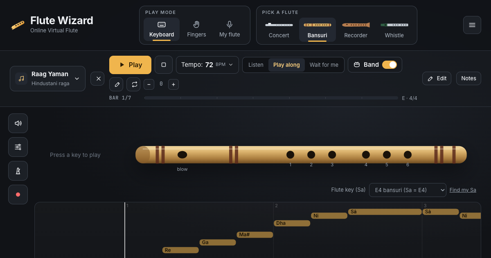

# Flute Wizard: a virtual flute in your browser

**Play it: https://veeragoni.github.io/flutewizard/**

Play the concert flute, bansuri, recorder and tin whistle online, with real recorded sound, live fingering diagrams, play-along songs and a backing band. Nothing to install and no account; your songs and recordings stay in your browser.



## What it does

- **Four flutes.** Concert flute, bansuri (Sargam names, any key from G3 to C5), soprano recorder and tin whistle (D, C, B♭, A, G, F, E♭ and low D).
- **Three ways to play.**
  - **Keyboard:** your computer keys are notes.
  - **Fingers:** cover holes on the keyboard or by tapping the flute.
  - **My flute:** play your real flute into the microphone, with *Find my Sa* to detect your flute's key and tuning.
- **Real sound.** Each flute is built from recorded notes, with a physical-model flute as an alternative. You can also record your own flute note by note and play with your own sound.
- **Songs.**
  - A public-domain library with a page for every song on every flute.
  - Paste or write your own songs:
    - letter notes
    - Sargam, including the styles used on Indian notation sites (`S’`, `’N`, `RgR…S`, `n.d.`, `Notes: s r2 g2…`)
    - ABC
  - Import MIDI and MusicXML files (`.mid`, `.musicxml`, `.mxl`).
- **Practice.** Listen, play along with scoring, or *wait for me* mode. Includes tempo, looping, transposition, a backing band (pop to teentaal), tanpura and shruti drones, and a metronome.
- **More.** Recording with WAV export, effects (reverb rooms, delay, EQ), a tuner and fingering charts.

## Run it locally

```sh
npm install
npm run dev      # http://localhost:5173
npm test         # unit tests
npm run build    # production build in dist/ (pre-renders the song pages)
```

It needs Node 20.19 or newer. Every push to `main` deploys to GitHub Pages through `.github/workflows/deploy.yml`.

## Analytics

Visits, pages, referrers, countries and devices are counted with **Cloudflare Web Analytics**, which uses no cookies, so no consent banner is needed. To turn it on:

1. In Cloudflare: **Analytics & Logs → Web Analytics → Add a site**, enter `veeragoni.github.io`, and copy the token from the JavaScript snippet (the `"token": "…"` value).
2. In GitHub: **Settings → Secrets and variables → Actions → Variables**, add `CF_BEACON_TOKEN` with that token, then re-run the Deploy workflow.

**Optional usage events.** These are anonymous counts:
- the flute picked
- the play mode
- built-in songs played (your own songs only as "own")
- imports, recordings and *Find my Sa*

Cloudflare can't count events, so they go to [GoatCounter](https://www.goatcounter.com/) when a `GOATCOUNTER_CODE` variable is set to your GoatCounter code. Without it, events are dropped. See `src/analytics.ts`.

## Writing songs

Open **Menu → Write or import a song** and paste notes. The editor shows a live preview with fingerings and flags anything it couldn't read. *How to write* in the editor lists the notation. Examples:

```
Title: Twinkle Twinkle
Tempo: 100
C C G G | A A G- | F F E E | D D C- |
```

```
Flute used for notations : G#
P PP… | M g RgR…S | D~S’ R’ g’ S’
```

## Credits

- **Inspiration:** [Guitoro](https://guitoro.com/), the online virtual guitar. Flute Wizard is an independent project with its own code, sounds and songs, and isn't affiliated with Guitoro.
- **Recordings:** these are listed with their licences on the app's [credits page](https://veeragoni.github.io/flutewizard/credits/) and in `public/samples/*.json`. They come from:
  - sankalp and roguentropy (bansuri)
  - Versilian Studios (concert flute and recorder)
  - cernoel, tychobrailleur and Jules Grandgagnage (tin whistle)

  The tin-whistle notes F♯6–B6 come from a CC BY-SA 4.0 recording and are shared under that licence.
- **Modelled flute:** based on Perry R. Cook's waveguide flute (Synthesis ToolKit).
- **Songs:** the built-in songs are public domain or traditional.
